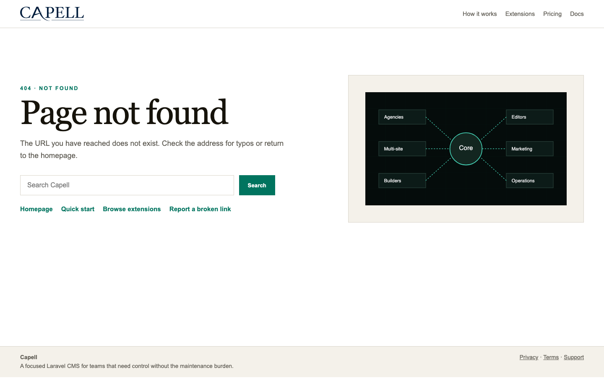
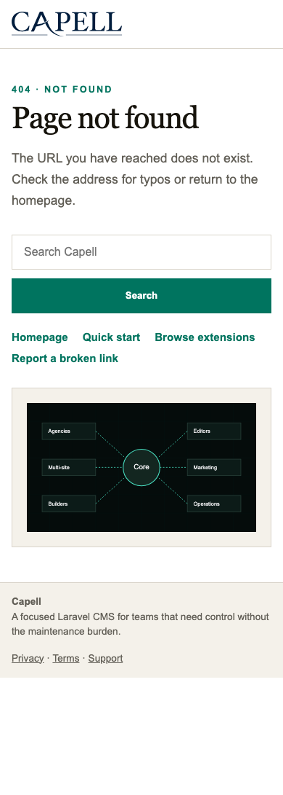

# Smart 404

<!-- prettier-ignore-start -->

## What It Does

Smart 404 turns missing-page dead ends into a short list of deterministic, site-scoped public URL suggestions.

- **Price and availability:** Check current availability and price on the [Capell Marketplace listing](https://capell.app/extensions/smart-404).
- **Licence:** Check the licence terms on the [Capell Marketplace listing](https://capell.app/extensions/smart-404).
- **Requires:** `PHP ^8.4`, `capell-app/admin ^1.0.66`, `capell-app/core ^1.0.66`, `capell-app/discovery-foundation ^1.0`, `capell-app/frontend ^1.0.72`, `laravel/framework ^12.41.1|^13.0`, `lorisleiva/laravel-actions ^2.8`, `spatie/laravel-data ^4.5`, `spatie/laravel-package-tools ^1.14.1`.
- **Install:** `composer require capell-app/smart-404`.

Frontend and static 404 documents keep their 404 status while similar links and nearby hierarchy are available with or without JavaScript.

## Who It Is For

**For developers:** The resolver uses the shared registry, a fixed similarity threshold, safe relative URLs, and a bounded public endpoint rather than application-specific queries in Blade.

**For teams:** Visitors get useful next steps without redirects, visitor tracking, AI services, or exposing unpublished content.

## Quick Start

1. Install the package: `composer require capell-app/smart-404`.
2. Open the package admin surface at `/admin/extensions` and confirm Smart 404 is available.

## Configure

- **Configuration files:** `config/capell-smart-404.php`.
- **Admin settings:** `Capell\Smart404\Settings\Smart404Settings`.

## Limits And Pitfalls

- Install the required Capell packages at the versions in `composer.json`: `capell-app/admin ^1.0.66`, `capell-app/core ^1.0.66`, `capell-app/discovery-foundation ^1.0`, `capell-app/frontend ^1.0.72`.
- Review middleware, throttling, signatures, and public-output safety in `routes/web.php` before exposing routes.
- Keep public Blade and cached HTML free of authoring markers, model IDs, permissions, signed editor URLs, and lazy database queries.
- Custom write integrations must preserve invalidation for `smart-404` cache tags.

## Screens And Workflow

- Smart 404 suggestions on a missing public page (desktop) (frontend).
- Smart 404 suggestions on a missing public page (mobile) (frontend).
- Smart 404 settings (admin).

## Install Impact

- Required packages: `capell-app/admin`, `capell-app/core`, `capell-app/discovery-foundation`, `capell-app/frontend`.
- Admin navigation: no admin page or resource contribution is declared.
- Admin/editor extensions: none declared.
- Permissions: no package permission declarations or Shield gates detected; host access rules still apply.
- Public routes: loads `routes/web.php`; registers `Smart404FrontendRoutesContribution`.
- Database changes: no package migrations declared.
- Config: `config/capell-smart-404.php`.
- Settings: `Capell\Smart404\Settings\Smart404Settings`.
- Queues or schedules: none declared.
- Cache tags: `smart-404`.
- Commands: none declared.

## Troubleshooting

| Symptom | Likely cause | Check | Fix |
| --- | --- | --- | --- |
| Package surface is missing after install | Provider or manifest is not loaded | Confirm `capell.json`, package `composer.json`, and provider registration | Reinstall the package, refresh Composer autoload, and clear host caches |
| Route returns unexpected output | Route cache, middleware, or signed URL setup does not match the package route file | Check the route files listed in `Technical Shape` | Clear route cache and verify middleware before exposing public routes |
| Public output leaks unexpected state | Render data, cache variation, or authoring boundary has regressed | Check public Blade, cache tags, and public-output safety tests | Move data loading out of Blade and rerun the package public-output tests |

## Upgrading

No manual steps between minor versions.

## Next Steps

- [Package docs](docs/README.md)
- [Overview](docs/overview.md)
- [Worked extension examples](docs/extension-contracts.md)
- Configuration files: [`config/capell-smart-404.php`](config/capell-smart-404.php).
- [Troubleshooting](#troubleshooting)
- [Developer reference](docs/reference.md)
- [Marketplace assets](docs/assets/marketplace/)
- [Capell content language plan](../../docs/CONTENT_LANGUAGE_PLAN.md)
- [Capell documentation design system](../../docs/DESIGN_SYSTEM.md)
- [Capell and package ERD notes](../../docs/erd/capell-and-package-erds.md)
- Related packages: [Discovery Core](../discovery-foundation/README.md), [Site Discovery](../site-discovery/README.md).

<!-- prettier-ignore-end -->
