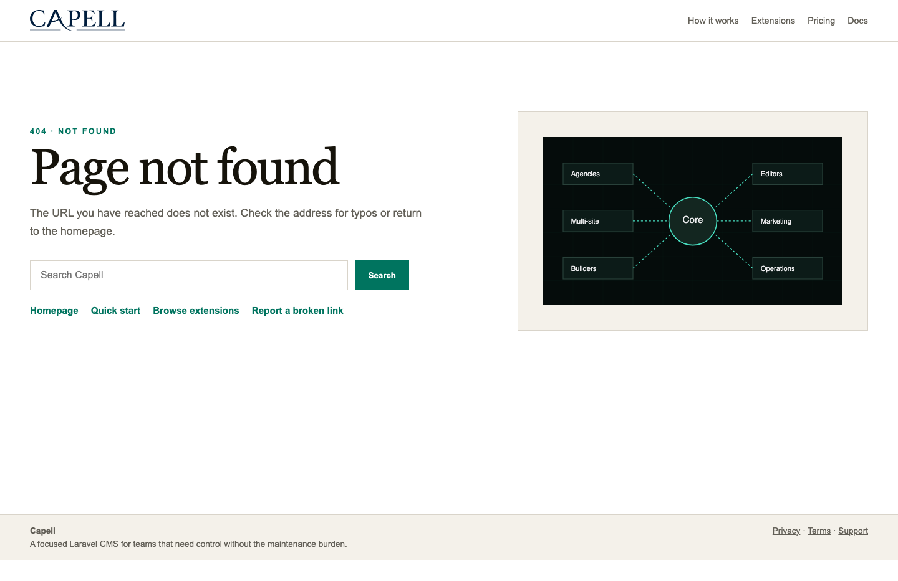
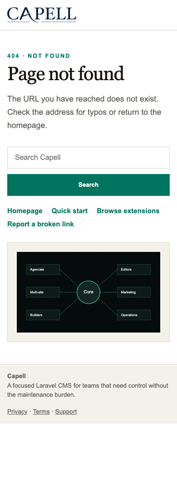

# Smart 404

<!-- prettier-ignore-start -->

Someone who types /pricng into your site lands on the not found page with Pricing suggested underneath. Smart 404 adds a short list of pages under the message, picked by how closely they match the address the visitor asked for. It compares the address, mostly its last part, with the names and addresses of your live public pages.

In the admin, open Extensions and find Smart 404. A switch turns it on or off, and a number sets how many suggestions to show, from 1 to 10, starting at five. Anyone who can open the Extensions settings can change them. Suggestions come only from the same site and language, and always from pages search engines are allowed to list. On larger sites only the first 250 public addresses, in alphabetical order, are searched. The page keeps its not found status and visitors are not redirected.

Each suggestion is a link using the page's label in the visitor's language, or its title if it has no label. If too few pages match, the list is filled up from the nearest parent page that does exist. A missing /services/old-thing offers Services and the pages beneath it.

- **Price and availability:** Check current availability and price on the [Capell Marketplace listing](https://capell.app/marketplace/extensions/smart-404).
- **Licence:** Check the licence terms on the [Capell Marketplace listing](https://capell.app/marketplace/extensions/smart-404).
- **Requires:** `PHP ^8.4`, `capell-app/admin ^1.0.66`, `capell-app/core ^1.0.79`, `capell-app/discovery-foundation ^1.0`, `capell-app/frontend ^1.0.72`, `laravel/framework ^12.41.1|^13.0`, `lorisleiva/laravel-actions ^2.8`, `spatie/laravel-data ^4.5`, `spatie/laravel-package-tools ^1.14.1`.
- **Install:** `composer require capell-app/smart-404`.

## Quick Start

1. Install the package: `composer require capell-app/smart-404`.
2. Open the package admin surface at `/admin/extensions` and confirm Smart 404 is available.

## For Developers

The resolver uses the shared registry, a fixed similarity threshold, safe relative URLs, and a bounded public endpoint rather than application-specific queries in Blade.

## Configure

- **Configuration files:** `config/capell-smart-404.php`.
- **Admin settings:** `Capell\Smart404\Settings\Smart404Settings`.

## Limits And Pitfalls

- Install the required Capell packages at the versions in `composer.json`: `capell-app/admin ^1.0.66`, `capell-app/core ^1.0.79`, `capell-app/discovery-foundation ^1.0`, `capell-app/frontend ^1.0.72`.
- Review middleware, throttling, signatures, and public-output safety in `routes/web.php` before exposing routes.
- Keep public Blade and cached HTML free of authoring markers, model IDs, permissions, signed editor URLs, and lazy database queries.
- Custom write integrations must preserve invalidation for `smart-404` cache tags.

## Screens And Workflow

- Smart 404 suggestions on a missing public page (desktop) (frontend).
- Smart 404 suggestions on a missing public page (mobile) (frontend).
- Smart 404 settings (admin).

## Install Impact

- Required packages: `capell-app/admin`, `capell-app/core`, `capell-app/discovery-foundation`, `capell-app/frontend`.
- Admin navigation: no admin page or resource contribution is declared.
- Admin/editor extensions: none declared.
- Permissions: no package permission declarations or Shield gates detected; host access rules still apply.
- Public routes: loads `routes/web.php`; registers `Smart404FrontendRoutesContribution`.
- Database changes: no package migrations declared.
- Config: `config/capell-smart-404.php`.
- Settings: `Capell\Smart404\Settings\Smart404Settings`.
- Queues or schedules: none declared.
- Cache tags: `smart-404`.
- Commands: none declared.

## Troubleshooting

| Symptom | Likely cause | Check | Fix |
| --- | --- | --- | --- |
| Package surface is missing after install | Provider or manifest is not loaded | Confirm `capell.json`, package `composer.json`, and provider registration | Reinstall the package, refresh Composer autoload, and clear host caches |
| Route returns unexpected output | Route cache, middleware, or signed URL setup does not match the package route file | Check the route files listed in `Technical Shape` | Clear route cache and verify middleware before exposing public routes |
| Public output leaks unexpected state | Render data, cache variation, or authoring boundary has regressed | Check public Blade, cache tags, and public-output safety tests | Move data loading out of Blade and rerun the package public-output tests |

## Upgrading

No manual steps between minor versions.

## Next Steps

- [Package docs](docs/README.md)
- [Overview](docs/overview.md)
- [Worked extension examples](docs/extension-contracts.md)
- Configuration files: [`config/capell-smart-404.php`](config/capell-smart-404.php).
- [Troubleshooting](#troubleshooting)
- [Developer reference](docs/reference.md)
- [Marketplace assets](docs/assets/marketplace/)
- [Capell content language plan](../../docs/CONTENT_LANGUAGE_PLAN.md)
- [Capell documentation design system](../../docs/DESIGN_SYSTEM.md)
- [Capell and package ERD notes](../../docs/erd/capell-and-package-erds.md)
- Related packages: [Discovery Foundation](../discovery-foundation/README.md), [Site Discovery](../site-discovery/README.md).

<!-- prettier-ignore-end -->
